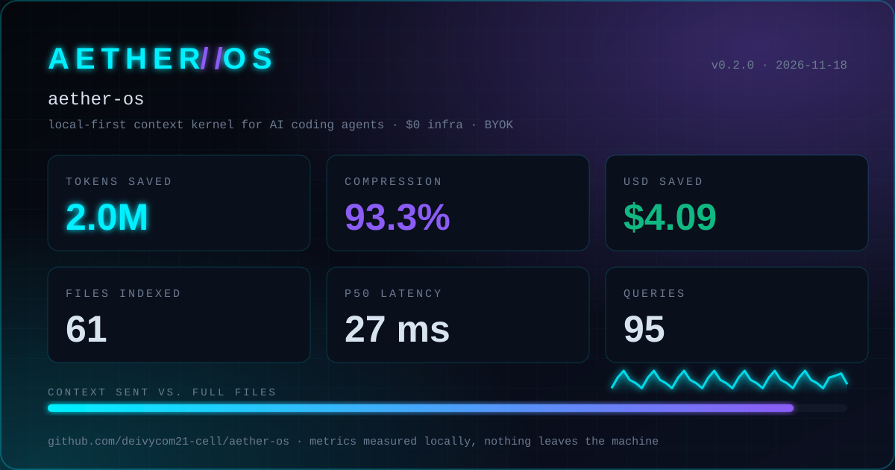

# AETHER//OS

**The local-first memory kernel for AI coding agents.**
Give Claude Code, Cursor, Windsurf, Cline, Zed and OpenCode a multi-repo code graph, compressed context,
a secret firewall, a memory of past bugs, time-travel snapshots, a self-healing test loop and a live 3D
view of your codebase that lights up as your agent works.

**93% fewer tokens per question. Zero servers. Zero accounts. One command.**


```
$ aether query "how are secrets masked before reaching the agent"
...
306,026 -> 21,498 tokens (-92.98%) across 15 real queries on this repo · p50 33 ms
```



---

## One-line setup

Open a terminal **inside your project** and paste one line:

**Windows (PowerShell)**

```powershell
irm https://raw.githubusercontent.com/deivycom21-cell/aether-os/main/install.ps1 | iex
```

**macOS / Linux**

```bash
curl -LsSf https://raw.githubusercontent.com/deivycom21-cell/aether-os/main/install.sh -o /tmp/aether-install.sh && sh /tmp/aether-install.sh
```

That's it. The installer:

1. installs [uv](https://docs.astral.sh/uv/) if you don't have it (uv fetches Python 3.12 when needed, so no Python install is required)
2. checks for git (on Windows it installs it with `winget` when missing)
3. installs AetherOS as an isolated tool and puts `aether` on your `PATH`
4. runs **`aether setup`** in the current folder, which does everything else:

```
1/6 prerequisites      Python and git, with the exact fix command for anything missing
2/6 code graph         indexes the repo (and --link-repo siblings) + runs the 6 built-in plugins
3/6 MCP clients        detects Claude Code, Cursor, Windsurf, Cline/Roo (VS Code), Zed, OpenCode
                       and registers the `aether` MCP server in each one's project config
4/6 pre-commit guard   blocks secrets / prompt injections in staged lines
5/6 agent rules        writes a live architecture block into CLAUDE.md / .cursorrules
6/6 live handshake     starts the MCP server exactly as your IDE will and lists its 16 tools
```

Then open the project in your agent (in Claude Code, approve the `aether` server and check it with
`/mcp`) and ask: *"use query_smart_context to explain this repo"*.

<details>
<summary><b>Setup options and manual install</b></summary>

```bash
aether setup                       # auto-detect IDEs (falls back to Claude Code + Cursor)
aether setup -c claude -c cursor   # only these clients   ·   aether setup --all   # every supported IDE
aether setup -l ../frontend        # link a sibling repo (frontend + backend in one graph)
aether setup --no-hooks --no-rules --no-verify
aether setup --here                # use a folder without .git / pyproject.toml / package.json ...
```

Installer variables: `AETHER_REF` (branch or tag, default `main`), `AETHER_SOURCE` (local checkout or
archive URL), `AETHER_SETUP_ARGS` (extra `aether setup` flags), `AETHER_SKIP_GIT=1` (Windows: don't
install git).

Already using uv? `uv tool install https://github.com/deivycom21-cell/aether-os/archive/refs/heads/main.zip`
then `aether setup`.

From a clone (contributors):

```powershell
uv venv .venv --python 3.12
uv pip install --python .venv\Scripts\python.exe -e ".[dev]"
.\.venv\Scripts\aether.exe setup
```

`aether setup` never runs if it can't find a project marker, so it will not index your home folder by
accident. It's safe to re-run: configs are merged (other MCP servers and settings are preserved), invalid
JSON files are left untouched, and an existing pre-commit hook is chained, not replaced.

</details>

---

## Why

Agents waste most of their context window reading entire files to find one function, they repeat bugs
the team already fixed, and they will happily paste a `.env` value into a prompt. AetherOS sits between
the agent and the repo:

| Problem | AetherOS |
|---|---|
| Agent reads 2,000-line files for one function | `query_smart_context` returns signatures, the exact matching fragment, dependencies and dependents within a token budget, and reports the tokens and dollars saved |
| "What breaks if I change this?" | `impact_analysis` follows imports, calls and **cross-repo HTTP calls** (frontend `fetch("/api/x")` → backend route) |
| The same bug comes back | **Scars**: recorded lessons plus scars mined from `fix/revert/crash` commits, injected as warnings when the agent touches that file |
| Tests are red and the agent flails | `heal` turns a failing run into one compact repair brief: frames, symbols, scars and context |
| Secrets leak into prompts | Regex + Shannon-entropy firewall with a reversible in-RAM vault: `<<AETHER_MASKED_SECRET_1>>` |
| Poisoned dependencies / docs | Prompt-injection detector (hidden comments, bidi unicode, base64 payloads, `curl \| sh`) |
| Risky multi-file edits | Content-addressed snapshots with one-command (or one-click) rollback |
| Context windows run out mid-task | Episodic checkpoints (< 400 tokens) and a per-session context-budget profiler |
| Big features | `aether swarm`: one git worktree per role (architect, builder, tester, security auditor), automatic verification and a safe merge |
| Cost | A router sends formatting/docs work to local Ollama or Haiku, and architecture work to Opus |

Everything runs on `localhost` with SQLite. No hosted services, no telemetry leaving your machine, no
model downloads. LLM calls are optional and use your own key (BYOK) or local Ollama.

---

## What's new in v0.2.0: 15 capabilities

| | Capability | Try it |
|---|---|---|
| 🩺 | [Auto-fix loop](#1-auto-fix-loop) | `aether heal "pytest -x"` |
| 📜 | [Living agent rules](#2-living-agent-rules) | `aether sync-rules` |
| 🧩 | [Six built-in plugins](#3-six-built-in-plugins) | `aether plugins` |
| 🃏 | [Share card](#4-share-card) | `aether share` |
| 🔌 | [Universal MCP installer + one-command setup](#5-universal-mcp-installer) | `aether setup` |
| 🔥 | [Hotspots (0-100 risk)](#6-hotspots) | `aether hotspots` |
| 🧠 | [Episodic memory](#7-episodic-memory) | `aether checkpoint` / `aether resume` |
| 🛡️ | [Pre-commit guard](#8-pre-commit-guard) | `aether install-hooks` |
| 🧬 | [Semantic diff](#9-semantic-diff) | `aether semantic-diff main` |
| 🛰️ | [3D radar, fly-to camera, Web Audio](#10-3d-radar-fly-to-camera-and-web-audio) | `aether web --open` |
| 🪦 | [Dead code](#11-dead-code) | `aether dead-code` |
| 🧪 | [Test skeletons](#12-test-skeletons) | `aether gen-tests app/api.py` |
| 🔐 | [Permission sandbox](#13-permission-sandbox) | `aether policy` |
| 🗺️ | [Living docs (Mermaid)](#14-living-docs) | `aether docs` |
| 📊 | [Context budget profiler](#15-context-budget-profiler) | `aether budget` |

### 1. Auto-fix loop

Runs your test or build command, parses Python/pytest, Node, `tsc`, Go and Rust failures, maps every
stack frame to the enclosing symbol in the graph and attaches the matching scars and smart context.
The result is a single repair brief in `.aether/last_heal_context.json` (or one MCP call).

```bash
aether heal "python -m pytest -x"          # diagnose: brief for your agent
aether heal "npm test" --execute           # repair with your own model: max 3 attempts,
                                           # safety snapshot first, automatic rollback on failure
```

MCP: `prepare_heal_context`. Only commands allowed by `.aether/policy.json` can run.

### 2. Living agent rules

Keeps a `<!-- AETHER:START --> … <!-- AETHER:END -->` block in `CLAUDE.md`, `.cursorrules` or
`AGENTS.md` in sync with the real modules, API routes, decisions, critical scars and hotspots. Text
outside the markers is never touched.

```bash
aether sync-rules                 # CLAUDE.md + .cursorrules
aether sync-rules -t AGENTS.md    # any rules file
```

### 3. Six built-in plugins

| Plugin | What it adds to the graph |
|---|---|
| `docker_inspector` | compose services, ports, running containers |
| `git_history_scars` | preventive scars mined from `fix` / `revert` / `crash` commits |
| `env_shield` | `.env` vs `.env.example`, leaked example values, un-ignored env files (variable **names** only) |
| `db_schema_inspector` **new** | tables/columns from `.sql`, `schema.prisma`, SQLAlchemy/SQLModel/Pydantic models and local SQLite (opened read-only; rows are never read) |
| `runtime_log_watcher` **new** | exceptions repeated in local `*.log` files become preventive scars on the originating function (secret-masked) |
| `dep_auditor` **new** | unpinned or URL-sourced dependencies, custom package indexes, risky `postinstall`-style scripts (fully offline) |

Project plugins live in `.aether/plugins/*.py`, subclass `plugins.base.BaseAetherPlugin`, and load only
when listed in `trusted_plugins` in `.aether/config.json` and they pass a static audit (no
`eval`/`exec`/`subprocess`/sockets).

### 4. Share card

A self-contained 1200×630 SVG with your **real, locally measured** savings (tokens, USD, latency), with no
external assets, ready for X, Reddit or a README.

```bash
aether share --out card.svg
```

### 5. Universal MCP installer

`aether setup` (above) or the lower-level `aether install-mcp` registers the server in every major
agentic IDE, merging into existing configs:

| Client | File |
|---|---|
| Claude Code | `.mcp.json` |
| Cursor | `.cursor/mcp.json` |
| Windsurf | `.windsurf/mcp.json` |
| Cline / Roo Code / Copilot (VS Code) | `.vscode/mcp.json` |
| Zed | `.zed/settings.json` (JSONC-safe) |
| OpenCode | `opencode.json` |

```bash
aether install-mcp --all        # or: -t claude -t zed   ·   --dry-run   ·   --print
```

### 6. Hotspots

Every file gets a 0-100 technical-debt risk score from cyclomatic complexity (30 %), fan-in (25 %), git
churn (25 %) and scars (20 %), each with the reasons behind it. The 3D dashboard tints the riskiest files.

```
$ aether hotspots -n 3
 risk  file                        worst fn            fan-in  churn  scars
  77   aether_core/kernel.py       semantic_diff (19)      19      2      0
  75   aether_core/ast_indexer.py  _visit_func (35)        10      2      0
  73   aether_core/database.py     fts_search (15)         12      2      0
```

MCP: `get_code_hotspots`.

### 7. Episodic memory

Compact checkpoints (< 400 tokens): goal, files touched, pending work, decisions. Resume the task in
a fresh context window without re-explaining it.

```bash
aether checkpoint "Refactor payments" -p "restore charge_customer signature"
aether resume            # paste-ready brief for the new session
```

MCP: `save_session_checkpoint` / `resume_session`.

### 8. Pre-commit guard

Scans only the **added** lines of the staged diff for secrets and prompt injections. It's stdlib-only
(~30 ms scan) and chains your existing hook.

```bash
aether install-hooks       # --uninstall restores the previous hook
aether scan --staged
```

### 9. Semantic diff

A symbol-level diff against any git ref: functions, classes, methods and routes added, removed,
renamed (shape hash) or signature-changed, with signature changes flagged as **potentially breaking**.

```bash
aether semantic-diff main
# vs main · 30 files · +286 -0 ~4 signatures · 30 bodies · 0 renamed · 4 potentially breaking
# aether_core/ast_indexer.py (modified)
#   + function aether_core.ast_indexer.is_virtual_path  def is_virtual_path(rel: str) -> bool
#   * class aether_core.ast_indexer.Indexer (body)
```

MCP: `semantic_diff` (compact by design: clipped signatures, body edits counted, ≤ 25 files).

### 10. 3D radar, fly-to camera and Web Audio

`aether web --open` serves the digital twin at `http://127.0.0.1:7777`:

* **Fly-to camera**: clicking a node or a search hit glides the camera to it.
* **Radar filters** `ALL · HOTSPOTS · SCARS · ROUTES`: hotspots glow red/amber, scars and routes isolate
  fragile files and the API surface. The choice is mirrored in `#radar=hotspots`, so you can share the view.
* **Web Audio synthesizer** (`AUDIO: OFF/ON`): every event type has its own synthesized tone, with zero
  audio files.
* **Context-budget gauge** that flashes when `BUDGET_WARNING` fires.

### 11. Dead code

Zero-reference functions, classes and methods (resolved graph edges + a textual cross-check) and
endpoints that no client consumes. Routes, registered callbacks, tests and CLI entrypoints are excluded.

```bash
aether dead-code -c high
```

MCP: `find_dead_code`.

### 12. Test skeletons

Generates runnable pytest files (signature locks, smoke calls, FastAPI/Flask route probes) or vitest
files for TypeScript/JavaScript.

```bash
aether gen-tests app/api.py         # writes tests/test_api_generated.py
aether gen-tests src/cart.ts --print
```

### 13. Permission sandbox

`.aether/policy.json` controls what agents can see and touch:

```json
{
  "deny": [".env", "*.pem", "secrets/**"],
  "read_only": ["migrations/**"],
  "allowed_commands": ["pytest", "npm test"],
  "scan_ignore": ["tests/fixtures/**"]
}
```

It's enforced by queries, impact analysis, rollback, heal, docs, rules and the dashboard API. An invalid
policy fails closed (read-only lockdown).

```bash
aether policy --check app/api.py     aether policy --read-only "docs/**"
```

MCP: `check_path_policy`.

### 14. Living docs

A Mermaid module-dependency diagram (cross-repo HTTP edges included) plus an API endpoint table with
the consumers of each route, written to `docs/AETHER_DOCS.md`.

```bash
aether docs                  # --print to stdout · --out docs/ARCH.md
```

### 15. Context budget profiler

Every MCP response is metered per session, tool, file and query. A `BUDGET_WARNING` hits the HUD at
80 %, 100 %, 150 %, 200 % and 300 % of the budget.

```
$ aether budget
session live-v020-demo · 42,096 tokens (70.2% of 60,000) · 11 tool calls
  semantic_diff          1 call   26,642 tokens
  query_smart_context    2 calls   5,697 tokens
  ...
```

MCP: `get_context_budget`.

---

## MCP tools (16)

| Tool | What it does |
|---|---|
| `query_smart_context(query, max_tokens=1500)` | Hybrid FTS5-BM25 + TF-IDF vector search, fused with RRF, then packed into a token budget: signatures, docstrings, matching fragments, deps/dependents, scars, savings metrics |
| `impact_analysis(file_path)` | Transitive dependents, endpoints defined, endpoint consumers in linked repos, risk score |
| `record_scar(file_path, error_summary, fix_applied, severity)` | Remember a bug and its fix |
| `check_scars(file_path)` | Warnings before editing |
| `create_snapshot(label)` | Content-addressed time-travel snapshot |
| `rollback_snapshot(snapshot_id)` | Restore a snapshot (a safety snapshot is taken first) |
| `scan_security(target_path=".")` | Secrets + prompt-injection audit (values are never returned) |
| `get_telemetry_stats()` | Tokens and USD saved, graph size, security counters, swarm state, context budget |
| `prepare_heal_context(command="", output="")` | Run an allowed test/build command (or analyse output you already have): errors, project frames with code windows, enclosing symbols, scars and smart context in one call |
| `get_code_hotspots(limit=15)` | Files ranked by technical-debt risk, with the reasons behind each score |
| `semantic_diff(ref="HEAD", paths=None, max_files=25)` | Symbol-level diff with breaking changes flagged |
| `find_dead_code(min_confidence="medium")` | Orphan symbols and unconsumed endpoints, with confidence levels |
| `save_session_checkpoint(goal, files_touched, pending, decisions, notes)` | Episodic memory across context windows |
| `resume_session(checkpoint_id=0)` | Latest (or given) checkpoint, paste-ready |
| `check_path_policy(path)` | Whether a path is readable/writable under `.aether/policy.json` |
| `get_context_budget()` | Tokens this session has consumed per tool, file and query vs. the budget |

Resources: `aether://telemetry`, `aether://scars`, `aether://graph/summary`, `aether://decisions`,
`aether://policy`, `aether://session/latest`. Every tool response is secret-masked first and then metered
by the context-budget profiler.

**Recommended agent workflow:** `query_smart_context` before opening large files → `check_scars` +
`impact_analysis` before editing → `create_snapshot` before risky multi-file edits → `semantic_diff` to
review → `prepare_heal_context` on red tests, `record_scar` after the fix → `save_session_checkpoint`
before ending the session.

---

## CLI reference

| Area | Commands |
|---|---|
| **Setup** | `aether setup [-c CLIENT]... [--all] [-l REPO]... [--no-hooks] [--no-rules] [--no-verify] [--here]` · `aether init [--link-repo PATH]...` · `aether install-mcp [--all \| -t zed] [--dry-run] [--print]` · `aether install-hooks [--uninstall \| --status]` · `aether version` |
| **Graph** | `aether index [--force]` · `aether link PATH` · `aether unlink NAME` · `aether repos` · `aether watch` |
| **Context** | `aether query "..." [-t 1500] [--json]` · `aether impact FILE` · `aether route "prompt"` |
| **Memory** | `aether scar FILE "error" --fix "..."` · `aether scars [FILE]` · `aether decision TITLE BODY` · `aether checkpoint "goal" [-p "next"]` · `aether resume [ID] [--list]` · `aether export-brain` · `aether import-brain [--path FILE]` |
| **Time travel** | `aether snapshot [LABEL]` · `aether snapshots` · `aether diff ID` · `aether rollback ID [-y]` |
| **Analysis** | `aether hotspots [-n 15]` · `aether semantic-diff [REF] [-p FILE]` · `aether dead-code [-c high]` · `aether docs [--print \| --out FILE]` · `aether gen-tests FILE [--print]` |
| **Healing** | `aether heal "CMD" [--execute]` |
| **Security** | `aether scan [PATH] [--staged]` · `aether policy [--check P] [--read-only G]` |
| **Agents & rules** | `aether sync-rules [-t AGENTS.md] [--dry-run]` · `aether mcp` · `aether budget [--threshold N]` |
| **Swarm** | `aether swarm "feature" [--execute]` · `aether swarm-status [ID]` · `aether swarm-execute ID` · `aether swarm-verify ID` · `aether swarm-merge ID` · `aether swarm-cleanup ID` |
| **Visibility** | `aether web [--open]` · `aether tui` · `aether stats` · `aether share [--out card.svg]` · `aether benchmark` · `aether plugins` |

Every command accepts `--root PATH`; most accept `--json`. Run `aether COMMAND --help` for details.

---

## The 3D digital twin

`aether web` serves a self-contained page (Three.js from a CDN, with an automatic Canvas 2D fallback
when you're offline or WebGL is unavailable). Files are nodes clustered by repository and directory,
dependencies are edges, and every kernel event (`CONTEXT_QUERY`, `SCAR_TRIGGERED`, `SECRET_BLOCKED`,
`SWARM_STEP`, `SNAPSHOT_CREATED`, `BUDGET_WARNING`) sends light pulses from the core to the files
involved, live over `/ws/telemetry`. Events are shared through SQLite, so the dashboard animates what the
MCP server inside Claude Code is doing in another process. Hover a node for details, click it for
symbols, dependencies, scars and impact analysis, and roll back snapshots from the side panel.

`aether tui` is the terminal version: KPIs, a savings sparkline, the live event bus, scars and snapshots,
with `i` (re-index), `s` (snapshot) and `x` (scan) key bindings.

---

## Benchmark v0.2.0 (this repository)

`aether benchmark` (or `python benchmarks/run_benchmark.py`) indexes the repo into a throwaway database
and runs 15 realistic queries. Results on a Windows 11 laptop with Python 3.12 (timings vary with machine
load):

| Metric | v0.2.0 | v0.1.0 |
|---|---|---|
| Graph | 63 files · 1,011 symbols · 5,051 edges | 36 files · 610 symbols · 2,915 edges |
| Cold index / warm re-index | 3,531 ms / 175 ms | 876 ms / 70 ms |
| Query latency | p50 33 ms · p95 40 ms | p50 33 ms · p95 48 ms |
| Tokens (raw files of the hits → AetherOS package) | 306,026 → 21,498 (**92.98% saved**) | 224,297 → 21,000 (90.6%) |
| Input cost saved over the 15 queries | $0.57 Sonnet 5.5 · $1.14 Opus 5.5 | $0.41 · $0.81 |

The permission policy adds ~1.5 ms per query (one policy snapshot per query, with decisions memoised per path).

"Raw" counts the full files an agent would otherwise open to see those hits, so the comparison is
conservative for big repos and generous for tiny files. When a package would cost more than the raw
files (tiny repos), the savings are reported as 0 rather than a negative number.

---

## Swarm orchestration

```powershell
aether swarm "Add a discount engine with per-customer rules"
# -> .aether/worktrees/<run>/{architect,builder,tester,security_auditor} + briefs/<role>.md
#    work in each worktree with your agent (or pass --execute to use your own API key / Ollama)
aether swarm-verify <run>     # merges role branches in an integration worktree, runs tests + secret scan
aether swarm-merge  <run>     # snapshot, then --no-ff merge into your branch
aether swarm-cleanup <run>
```

With `--execute`, roles call the official Anthropic SDK (`pip install "aether-os[llm]"`, reads
`ANTHROPIC_API_KEY`) or a local Ollama at `http://localhost:11434`. Tiers default to `claude-haiku-5-5`,
`claude-sonnet-5-5` and `claude-opus-5-5`; override them with `AETHER_FAST_MODEL`, `AETHER_BALANCED_MODEL`,
`AETHER_ARCHITECT_MODEL` and `AETHER_OLLAMA_MODEL`.

---

## Security notes

* The dashboard binds to `127.0.0.1`, checks the `Host` header, and requires a per-process token for
  every mutating endpoint. Foreign WebSocket origins are rejected.
* The vault that maps `<<AETHER_MASKED_SECRET_N>>` back to values exists only in process memory.
* `.env`, private keys and certificates are never indexed, and the default policy denies them.
* `.aether/policy.json` hides paths from agents (`deny`), protects them from every AetherOS write
  (`read_only`) and restricts which commands `heal` may run (`allowed_commands`).
* `aether install-hooks` blocks commits whose added lines contain secrets or prompt injections. Bypass a
  false positive once with `git commit --no-verify`, or permanently with `scan_ignore`.
* The one-line installers only download uv (from astral.sh), git (Windows, via winget) and this
  repository. Read them first: [`install.ps1`](install.ps1), [`install.sh`](install.sh).
* Detection is heuristic. It's a safety net, not a replacement for a secrets manager or code review.

## Supported languages

Python (native AST: classes, functions, methods, imports, calls, FastAPI/Flask routes with router
prefixes), TypeScript/JavaScript (functions, arrow functions, classes and methods, interfaces, imports,
Express and Next.js routes, `fetch`/`axios` calls), Go, Rust (actix/axum routes), JSON (`package.json`
dependencies and scripts), Dockerfile, Markdown sections, SQL tables, and YAML/TOML/HTML/CSS/shell as
module nodes.

## Development

See [CONTRIBUTING.md](CONTRIBUTING.md), [ARCHITECTURE.md](ARCHITECTURE.md) and [CLAUDE.md](CLAUDE.md).

```powershell
uv venv .venv --python 3.12
uv pip install --python .venv\Scripts\python.exe -e ".[dev]"
.\.venv\Scripts\python.exe -m pytest      # 118 tests, needs git on PATH
```

MIT licensed.
