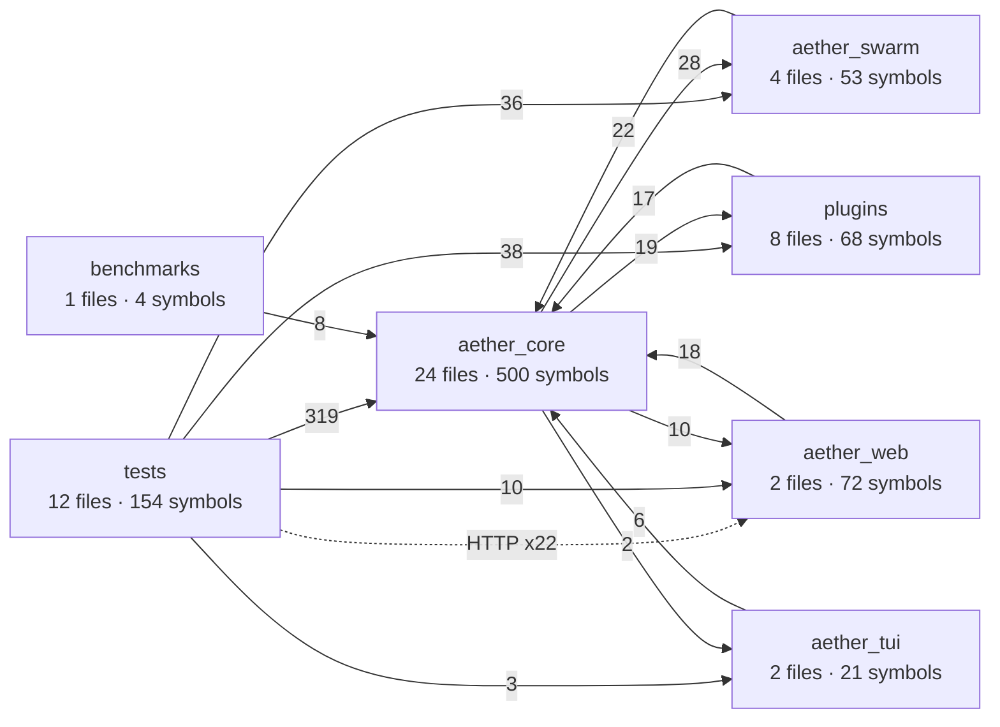

# aether-os — living architecture docs

_Generated by `aether docs` on 2026-11-18 from index v11. Re-run after structural changes; manual edits to this file are overwritten._

## Module dependency graph

## Modules

| repo | module | files | symbols | lines | languages |
|---|---|---:|---:|---:|---|
| aether-os | `aether_core` | 24 | 500 | 8272 | python |
| aether-os | `tests` | 12 | 154 | 2321 | python |
| aether-os | `aether_web` | 2 | 72 | 270 | python |
| aether-os | `plugins` | 8 | 68 | 1368 | python |
| aether-os | `aether_swarm` | 4 | 53 | 841 | python |
| aether-os | `aether_tui` | 2 | 21 | 271 | python |
| aether-os | `benchmarks` | 1 | 4 | 151 | python |

## API endpoints (21)

| method | path | handler | location | consumers |
|---|---|---|---|---|
| `GET` | `/` | `aether_web.server.create_app.index` | aether-os:aether_web/server.py:86 | — |
| `GET` | `/api/budget` | `aether_web.server.create_app.budget` | aether-os:aether_web/server.py:166 | — |
| `GET` | `/api/checkpoints` | `aether_web.server.create_app.checkpoints` | aether-os:aether_web/server.py:174 | — |
| `GET` | `/api/events` | `aether_web.server.create_app.events` | aether-os:aether_web/server.py:137 | — |
| `GET` | `/api/file` | `aether_web.server.create_app.file_detail` | aether-os:aether_web/server.py:118 | — |
| `GET` | `/api/graph` | `aether_web.server.create_app.graph` | aether-os:aether_web/server.py:100 | — |
| `GET` | `/api/hotspots` | `aether_web.server.create_app.hotspots` | aether-os:aether_web/server.py:162 | — |
| `GET` | `/api/impact` | `aether_web.server.create_app.impact` | aether-os:aether_web/server.py:154 | — |
| `POST` | `/api/index` | `aether_web.server.create_app.reindex` | aether-os:aether_web/server.py:201 | — |
| `GET` | `/api/policy` | `aether_web.server.create_app.policy` | aether-os:aether_web/server.py:170 | — |
| `POST` | `/api/query` | `aether_web.server.create_app.query` | aether-os:aether_web/server.py:180 | — |
| `GET` | `/api/repos` | `aether_web.server.create_app.repos` | aether-os:aether_web/server.py:150 | — |
| `POST` | `/api/scan` | `aether_web.server.create_app.scan` | aether-os:aether_web/server.py:197 | — |
| `GET` | `/api/scars` | `aether_web.server.create_app.scars` | aether-os:aether_web/server.py:141 | — |
| `GET` | `/api/snapshots` | `aether_web.server.create_app.snapshots` | aether-os:aether_web/server.py:146 | — |
| `POST` | `/api/snapshots` | `aether_web.server.create_app.create_snapshot` | aether-os:aether_web/server.py:184 | — |
| `POST` | `/api/snapshots/{snapshot_id}/rollback` | `aether_web.server.create_app.rollback` | aether-os:aether_web/server.py:188 | — |
| `GET` | `/api/stats` | `aether_web.server.create_app.stats` | aether-os:aether_web/server.py:96 | — |
| `GET` | `/api/swarm` | `aether_web.server.create_app.swarm` | aether-os:aether_web/server.py:158 | — |
| `GET` | `/healthz` | `aether_web.server.create_app.healthz` | aether-os:aether_web/server.py:91 | — |
| `ANY` | `/ws/telemetry` | `aether_web.server.create_app.telemetry` | aether-os:aether_web/server.py:206 | — |
